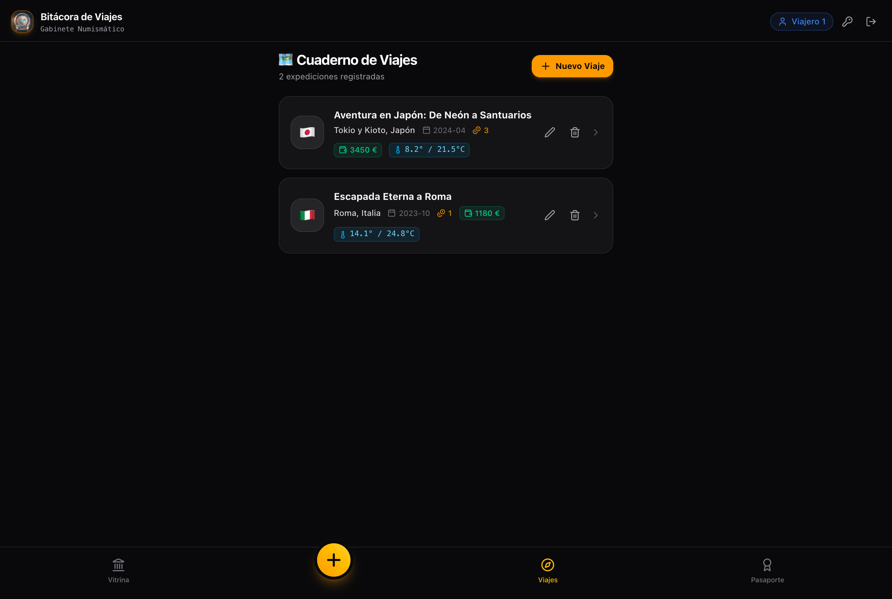
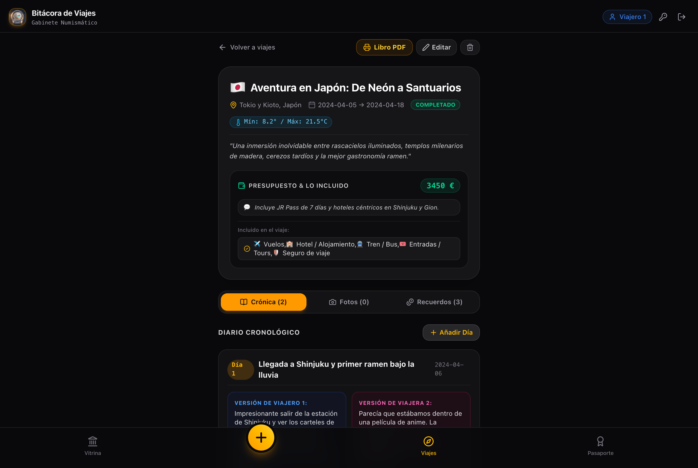
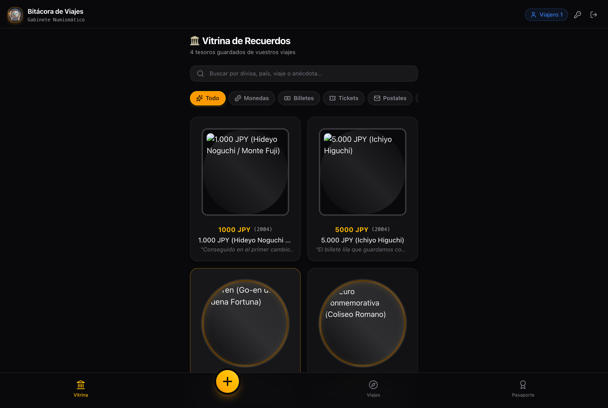
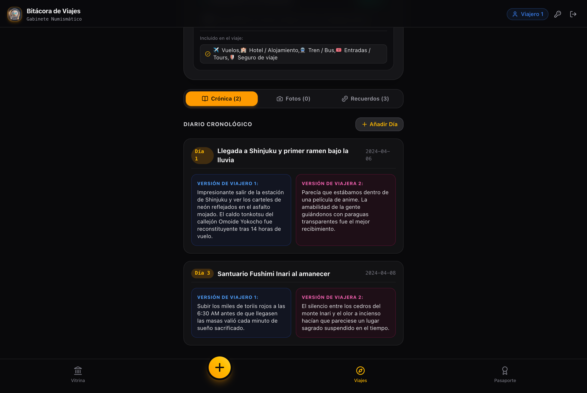
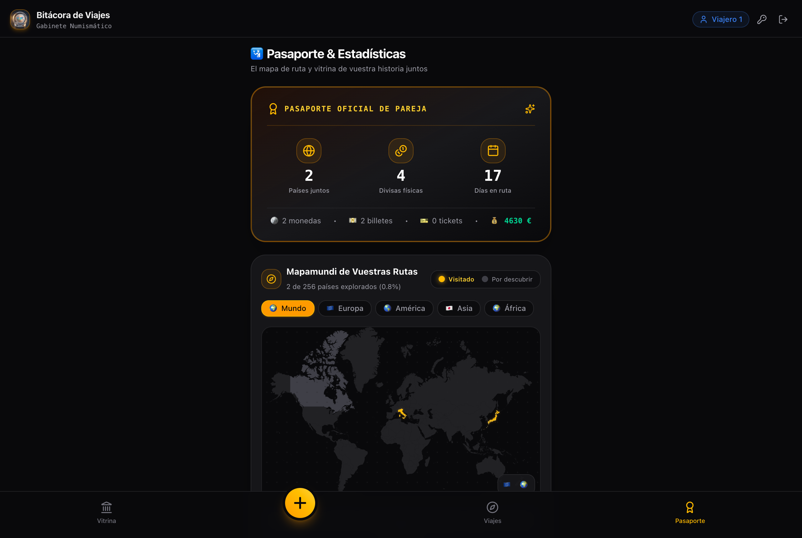
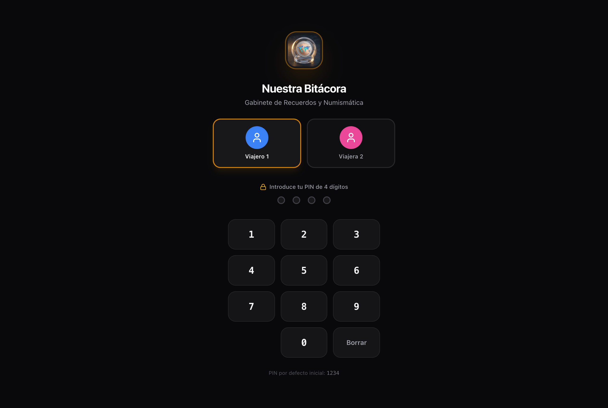
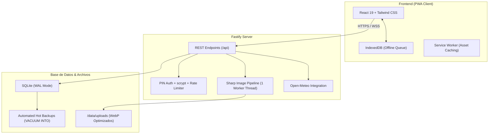

<p align="center">
  
</p>

<h1 align="center">✈️ Bitácora de Viajes en Pareja</h1>
<p align="center"><b>Gabinete Numismático 3D • Crónica a Dos Voces • Álbum Editorial • PWA Offline-First</b></p>

<p align="center">
  
  
  
  
  
  
</p>

<p align="center">
  <a href="#-demostración-visual">Demostración</a> •
  <a href="#-características-destacadas">Características</a> •
  <a href="#-despliegue-rápido-con-docker">Despliegue</a> •
  <a href="#-variables-de-entorno">Configuración</a> •
  <a href="#-arquitectura-técnica">Arquitectura</a> •
  <a href="#-seguridad-y-resiliencia">Seguridad</a>
</p>

---

## 📖 Introducción

**Bitácora de Viajes** es una aplicación web progresiva (**PWA**) privada y autoalojable creada específicamente para parejas que viajan juntas. 

A diferencia de las redes sociales convencionales, se enfoca en la intimidad del viaje: registrar anécdotas conjuntas desde dos puntos de vista simultáneos (**crónica a dos voces**), calcular el **clima histórico** real vivido en cada ciudad, documentar costes e inclusiones, imprimir un **libro de viaje editorial** en PDF y preservar los recuerdos tangibles en un **gabinete numismático interactivo en 3D**.

---

## 📸 Demostración Visual

### 🗺️ Cuaderno de Viajes & Crónica a Dos Voces
| Listado de Expediciones y Presupuestos | Detalle del Viaje & Crónicas Simultáneas |
| :---: | :---: |
|  |  |

### 🪙 Gabinete Numismático & Series Oficiales de Divisas
| Vitrina Numismática 3D Interactiva | Series Circulantes (Color / Blanco y Negro) |
| :---: | :---: |
|  |  |

### 📖 Libro de Viaje Editorial & Pasaporte Digital
| Libro de Viaje Maquetado para Imprimir (PDF A4) | Pasaporte & Mapamundi SVG Interactivo |
| :---: | :---: |
|  |  |

### 🔐 Pantalla de Inicio y Acceso Seguro
<p align="center">
  
</p>

---

## 🌟 Características Destacadas

### 1. 🪙 Gabinete Numismático y Cono Monetario
* **Visor Flip Card 3D:** Tarjetas táctiles interactivas con giro de 180° a 60–120 fps en CSS 3D nativo, simulando una cápsula de colección.
* **Series Circulantes Oficiales:** Álbum predefinido de billetes y monedas vigentes en el país durante el año de visita. Las piezas conseguidas se muestran a todo color y las pendientes en escala de grises.
* **Ficha Técnica Detallada:** Denominación, año de emisión, divisa y notas sobre cómo y dónde se obtuvo cada pieza.

### 2. 📝 Crónica Diaria a Dos Voces
* **Doble Perspectiva:** Cada jornada permite a ambos miembros de la pareja escribir su versión de los hechos de forma simultánea e independiente.
* **Álbum de Recuerdos Integrado:** Subida múltiple de fotografías por destino con selección de foto de portada.

### 3. 🖨️ Exportador Editorial (Libro de Viaje)
* Genera una maqueta editorial limpia en formato libro lista para imprimir o guardar como PDF en A4.
* Incluye cabecera con fechas, clima registrado, desglose de inversión, crónicas a dos columnas, galería de fotos seleccionadas y colofón final personalizado.

### 4. 🌤️ Meteorología Histórica Automatizada
* Consulta automática a la API abierta de **Open-Meteo** para registrar las temperaturas mínimas y máximas históricas vividas en las fechas y destino de la expedición.

### 5. 🗺️ Mapamundi Interactivo & Pasaporte
* Visualización gráfica en mapa SVG con coloreado dinámico de países visitados.
* Métricas de pareja: países recorridos, días totales en ruta y total de piezas numismáticas coleccionadas.

### 6. 📱 PWA Offline-First
* Instalable en iOS y Android con soporte offline completo mediante Service Worker.
* Cola de sincronización local en IndexedDB con identificadores UUIDv7 para registrar vivencias y fotos en modo avión o sin cobertura.

---

## 🏗️ Arquitectura Técnica



---

## 🚀 Despliegue Rápido con Docker

La forma más rápida de ejecutar Bitácora de Viajes en cualquier servidor o NAS doméstico:

```bash
# 1. Clonar el repositorio
git clone https://github.com/Wacko87/bitacora-viajes.git
cd bitacora-viajes

# 2. Configurar variables de entorno (opcional)
cp .env.example .env

# 3. Iniciar con Docker Compose
docker compose up -d
```

La aplicación estará disponible inmediatamente en `http://localhost:3040`.

---

## ⚙️ Variables de Entorno

| Variable | Descripción | Valor por Defecto |
|---|---|---|
| `NODE_ENV` | Entorno de ejecución (`production` o `development`) | `production` |
| `PORT` | Puerto de escucha del servidor HTTP | `3040` |
| `HOST` | Interfaz de red de escucha | `0.0.0.0` |
| `DATA_DIR` | Ruta persistente para la base de datos y uploads | `/data` |
| `TRUST_PROXY` | IPs o subredes de confianza tras el proxy inverso | `127.0.0.1,172.16.0.0/12,192.168.0.0/16` |
| `ALLOWED_DOMAINS` | Dominios autorizados para solicitudes CORS (separados por coma) | `localhost` |
| `DEFAULT_PARTNER_1_NAME` | Nombre inicial para el Viajero 1 | `Viajero 1` |
| `DEFAULT_PARTNER_2_NAME` | Nombre inicial para la Viajera 2 | `Viajera 2` |
| `SEED_DEMO` | Inicializa la base de datos con viajes y monedas de ejemplo | `false` |

---

## 🔒 Seguridad y Resiliencia

* **Cifrado de PIN:** Las contraseñas y códigos PIN de acceso se almacenan utilizando `scrypt` con sales criptográficas únicas.
* **Control contra Ataques de Fuerza Bruta:** Limitación estricta de peticiones (`@fastify/rate-limit`) con tarpit exponencial.
* **Validación de Subidas:** Detección de tipos MIME reales mediante verificación de *magic bytes* para evitar ejecución de archivos maliciosos.
* **Copias de Seguridad en Caliente:** Respaldos periódicos automáticos de SQLite mediante `VACUUM INTO` sin bloquear las lecturas/escrituras.
* **Cabeceras de Seguridad:** Políticas estrictas de `Content-Security-Policy`, `X-Frame-Options: DENY`, `X-Content-Type-Options: nosniff` y `Referrer-Policy`.

---

## 🛠️ Desarrollo Local

```bash
# Instalar dependencias
npm install

# Iniciar servidor backend y frontend en desarrollo
npm run dev

# Opcional: Cargar datos de demostración
npm run db:seed:demo

# Compilar para producción
npm run build
```

---

## 🤝 Contribuciones

Las sugerencias, reportes de errores y pull requests son bienvenidos. Siéntete libre de abrir un issue para proponer nuevas funcionalidades o mejoras en el gabinete numismático.
