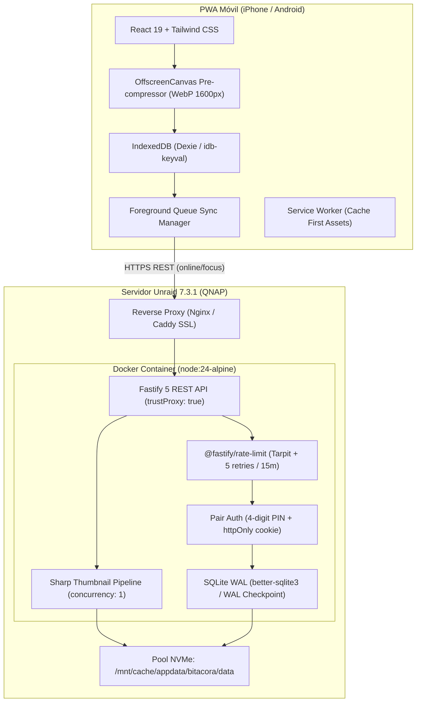

# Technical Design: Bitácora de Viajes en Pareja & Gabinete Numismático

* **Estado:** Especificación Técnica Consolidada
* **Fecha:** 21 de Noviembre de 2026
* **Despliegue:** Contenedor Docker autónomo con Proxy Inverso SSL

---

## 1. Visión y Definición del Problema

### El Problema
Las aplicaciones comerciales de viajes (Polarsteps, FindPenguins, Wanderlog) están enfocadas a la red social pública o a la planificación logística masiva. Ninguna ofrece un espacio íntimo exclusivo para una pareja centrado en poner en valor los **recuerdos físicos y tangibles** (billetes arrugados, monedas exóticas, tickets de metro, posavasos) que se traen de cada país y que terminan olvidados en un cajón.
Además, las aplicaciones existentes sufren del **Síndrome de Burocracia Vacacional**: formularios interminables que agotan a los viajeros en plena ruta, o dependencia de nubes de pago con suscripciones mensuales y telemetría.

### La Solución
Una PWA privada, autoalojada y autónoma en un único contenedor Docker para Unraid, diseñada para **dos personas**:
1. **Gabinete Numismático & Scrapbook (`artifacts`):** Colección táctil de monedas, billetes y recuerdos con visor 3D flip anverso/reverso, simulación de cápsula acrílica de museo y selector visual de monedas en 1 toque.
2. **Arquitectura TRIZ Bimodal:**
   * **Modo Ruta (5 segundos):** En plena calle, captura rápida de foto cenital asistida por giroscopio + toque en la silueta de divisa pre-cargada. Sin teclear.
   * **Modo Gabinete (Hotel / Casa):** Edición pausada con foto de reverso, anécdotas compartidas y datación de ceca/año.
3. **Diario a Dos Voces (`trip_logs`):** Crónica diaria con notas independientes para Perfil A y Perfil B.
4. **Pasaporte & Mapa Mundial:** Visualización interactiva de países visitados en común y estadísticas globales.

---

## 2. Metas y No-Metas

### Metas (v1.0 MVP)
* **Despliegue Autónomo Homelab:** Contenedor Docker único y liviano en Alpine con backend Fastify 5 y frontend Vite/React compilado estático, persistiendo a `/data` (mapeado al pool NVMe `/mnt/cache/appdata/bitacora/data`).
* **Offline-First Real para iOS y Android:** PWA con Service Worker para assets estáticos y una cola en primer plano (Foreground Queue Sync) sobre IndexedDB con UUIDv7 para registrar monedas o recuerdos en modo avión sin colisiones.
* **Pipeline Multimedia Liviano:** Pre-compresión obligatoria en cliente (`OffscreenCanvas`) a WebP máx. 1600px (~350 KB), con generación en servidor de miniaturas WebP (`sharp` con concurrencia restringida a 1 hilo).
* **Visor 3D Flip Card:** Efecto de volteo de moneda/billete 180° a 60-120fps utilizando CSS 3D nativo sin librerías pesadas.
* **Seguridad y Resiliencia:** Rate-limiting estricto (5 intentos/15 min + tarpit) para el PIN de 4 dígitos tras NPM (`trustProxy`), y parada limpia con `PRAGMA wal_checkpoint(TRUNCATE)` ante `SIGTERM` de Unraid.

### No-Metas (Diferidas a v2.0)
* No WebSockets de fondo persistentes (ahorro estricto de batería móvil).
* No generador algorítmico complejo de sellos aduaneros SVG (se usan banderas oficiales y badges limpios en v1.0).
* No gestor de Wishlist de viajes futuros (la bitácora v1.0 se enfoca exclusivamente en conservar el pasado y presente).
* No subida ni transcodificación de vídeo pesado (únicamente fotos optimizadas y recuerdos).

---

## 3. Critical User Journeys (CUJs)

### CUJ 1: Captura de Moneda en 5 Segundos en Plena Ruta ("Modo Ruta")
* **Contexto:** La pareja está en un puesto de comida en Tokio pagando con efectivo. Reciben una moneda de 500 yenes que quieren guardar.
* **Acción:** Uno de ellos abre la PWA desde la pantalla de inicio del móvil (la app detecta automáticamente el viaje activo a Japón).
* **Interacción:** Pulsa el botón flotante "+", apunta la cámara hacia la moneda apoyada en la mesa (el visor muestra un círculo con nivel de burbuja giroscópico que se pone verde a 90° evitando la sombra del teléfono), pulsa el disparador y toca la silueta "500 ¥". Pulsa "Guardar".
* **Resultado:** La moneda queda registrada en IndexedDB en 5 segundos sin escribir una sola palabra. La compresión local en WebP la prepara para subirse al llegar al Wi-Fi del hotel.

### CUJ 2: Enriquecimiento en el Hotel o en Casa ("Modo Gabinete")
* **Contexto:** Por la noche en el hotel o semanas después de vuelta en casa con la caja de monedas.
* **Acción:** Abren la ficha de la moneda de 500 yenes.
* **Interacción:** Toman la foto del reverso, escriben la anécdota ("El cambio del señor del puesto de takoyaki"), anotan el año de acuñación y guardan.
* **Resultado:** En la vitrina virtual, la moneda ahora se puede voltear en 3D con un gesto táctil mostrando ambas caras perfectamente encuadradas dentro de su cápsula acrílica.

### CUJ 3: Crónica Diaria a Dos Voces
* **Contexto:** Fin de la jornada de visita en Kioto.
* **Acción:** Ambos miembros acceden al viaje en curso. En la pestaña "Día 3", Perfil A escribe su perspectiva ("Lo mejor fueron los templos sin gente a primera hora") y Perfil B escribe la suya ("La caminata por el bosque de bambú bajo la lluvia").
* **Resultado:** La crónica refleja ambas miradas en paralelo sin pisarse ni generar conflictos de edición concurrente.

### CUJ 4: Consulta de la Colección y Mapa en Modo Avión
* **Contexto:** En el vuelo de regreso a casa sin conexión a internet ni Wi-Fi.
* **Acción:** Abren la PWA para recordar los viajes pasados o repasar las monedas traídas.
* **Resultado:** El Service Worker y la base local IndexedDB cargan instantáneamente la vitrina de monedas, fotos y mapa de países visitados. Si añaden una nota, se encola para sincronizar al aterrizar.

---

## 4. Arquitectura del Sistema



---

## 5. Contratos de API REST

### Autenticación y Perfiles
* `GET /api/auth/me`: Retorna el perfil autenticado actual (`{ profile: { id, name, avatar_url } }`) o 401.
* `POST /api/auth/login`: `{ profile_id: string, pin: string }`. Aplica rate limiting (5 intentos erróneos / 15m con tarpit de 2s). Emite cookie `session` `httpOnly`, `SameSite=Lax`, `Secure`.
* `POST /api/auth/logout`: Invalida la sesión y borra la cookie `httpOnly`.
* `GET /api/profiles`: Lista los 2 perfiles de la pareja.

### Viajes (`trips`)
* `GET /api/trips`: Lista todos los viajes ordenados por fecha con estadísticas (número de artefactos, días).
* `GET /api/trips/:id`: Detalle del viaje con sus logs y artefactos asociados.
* `POST /api/trips`: Crear o actualizar viaje (soporta upsert con UUIDv7):
  ```json
  {
    "id": "018e3c...",
    "title": "Aventura en Japón",
    "country_code": "JP",
    "city": "Tokio & Kioto",
    "start_date": "2026-04-10",
    "end_date": "2026-04-24",
    "status": "completed",
    "summary": "Viaje inolvidable entre rascacielos y templos."
  }
  ```
* `DELETE /api/trips/:id`: Soft delete (`deleted_at = CURRENT_TIMESTAMP`).

### Artefactos & Numismática (`artifacts`)
* `GET /api/artifacts?trip_id=...&category=...`: Lista filtrable de monedas, billetes y recuerdos.
* `POST /api/artifacts`: Upsert de artefacto:
  ```json
  {
    "id": "018e3c...",
    "trip_id": "018e3c...",
    "category": "coin",
    "title": "500 Yenes",
    "currency_code": "JPY",
    "denomination": "500",
    "year": 2023,
    "story": "Cambio del puesto de ramen.",
    "collector_profile_id": "profile_1"
  }
  ```
* `POST /api/artifacts/:id/upload`: Multipart upload de imágenes (`front` y opcional `back`). Redimensiona y guarda en `/data/uploads/{id}/front.webp` y `/data/uploads/{id}/thumb_front.webp`.

### Diario (`trip_logs`)
* `GET /api/trips/:tripId/logs`: Entradas cronológicas del viaje.
* `POST /api/trips/:tripId/logs`: Guardar o editar entrada de un día con notas de cada miembro:
  ```json
  {
    "id": "018e3c...",
    "trip_id": "018e3c...",
    "day_number": 3,
    "log_date": "2026-04-13",
    "title": "Día en Fushimi Inari",
    "notes_partner_1": "Subida mágica entre los torii.",
    "notes_partner_2": "Comimos unos dango deliciosos a mitad de camino."
  }
  ```

### Sincronización Delta (`sync`)
* `GET /api/sync?since=2026-11-20T00:00:00Z`: Devuelve todas las mutaciones (creaciones, modificaciones y borrados con `deleted_at`) ocurridas desde la marca temporal.
* `POST /api/sync/batch`: Recibe un lote de mutaciones offline de IndexedDB para procesamiento atómico en una única transacción SQLite.

---

## 6. Pipeline de Despliegue en Unraid

* **Directorio Host:** `/mnt/cache/appdata/bitacora/data` (sin intermediación de FUSE).
* **Variables de Entorno:**
  * `PORT=3000`
  * `DATA_DIR=/data`
  * `SESSION_SECRET=...` (autogenerado en setup)
  * `TRUST_PROXY=127.0.0.1,172.16.0.0/12,192.168.0.0/16`
* **Docker Multi-Stage:**
  * Stage 1: Build de frontend Vite (`npm run build`).
  * Stage 2: Compilación de backend TypeScript.
  * Stage 3: Runtime en `node:24-alpine` con `CMD ["node", "dist/server/index.js"]`. Fastify captura `SIGTERM` y ejecuta `PRAGMA wal_checkpoint(TRUNCATE); db.close();` en < 2 segundos.
